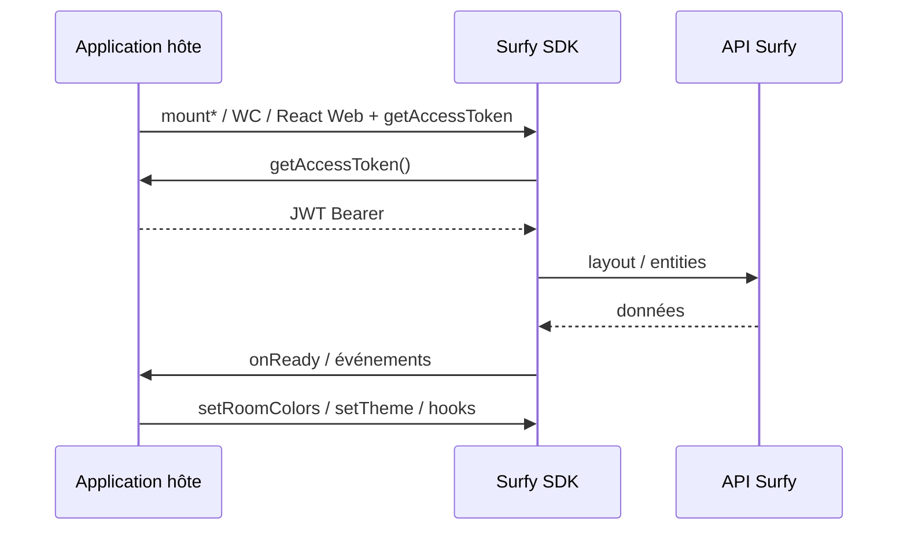

# Surfy SDK — intégration cartographie

Le **Surfy SDK** (`@surfy/surfy-sdk`) permet d'embarquer un **plan d'étage 2D**, un **bâtiment 3D**, ou une **Vue plateforme** (carte multi-bâtiments MapLibre + Cuby) en **lecture seule** — sans reconstruire la géométrie Surfy et **sans** exposer le `clientSecret` dans le navigateur.

### Nouveautés intégrateur (WI-429)

- **Plateforme React only** — `SurfyPlatformView3dReact` = **seule** surface React publique recommandée pour la carte globale ; campus / building / floor 3D React **dépréciés** — [Vue plateforme](./platform-campus-3d.md) · [Surfy React Web](./surfy-react-web.md)
- **Drill structure → Cuby** — clic structure → rendu Cuby style pathfinding (éclaté, RDC) **dans la même carte** ; **pas** d'itinéraire A→B — [drill](./platform-campus-3d.md#clic-structure--cuby-style-pathfinding-même-carte)
- **Couleurs structure** — massing aligné sur `Building.color` (même SSOT que le pathfinding bâtiment produit)
- **Parité React** (layouts legacy) — props / events / handle alignés sur l'API JS / WC — [Surfy React Web](./surfy-react-web.md)
- **Offline layout SDK** — `offlineEnabled` **défaut `true`**, SWR — [Offline layout](./surfy-react-web.md#offline-layout-étage--bâtiment) · [plateforme](./platform-campus-3d.md#offline-plateforme)
- **Pilotage contexte SDK** — focus bâtiment / étage via `useSetCurrentZoom` / callbacks — [pilotage](./platform-campus-3d.md#pilotage-du-contexte-focus-hôte)
- **MapLibre** — tuiles / style = **cache navigateur only** (pas de cache Surfy dédié)

## Surfaces de layout (+ plateforme + API données)

Les surfaces d'étage / bâtiment (API JS / WC) partagent les **mêmes sémantiques** (auth JWT machine, tenant, couleurs, sélection). La **Vue plateforme** est **React Web uniquement** :

| Surface | Import | Public cible |
|---------|--------|--------------|
| **API JavaScript** | `@surfy/surfy-sdk` → `SurfySdk.mountFloor2d` / `mountBuilding3d` | HTML, Vue, Angular, tout hôte DOM (étage / bâtiment) — **recommandé** hors carte globale |
| **Web Component** | mêmes tags (`surfy-floor-layout-2d`, `surfy-building-layout-3d`) | Markup HTML / frameworks non-React (étage / bâtiment) — **conservés** |
| **Surfy React Web** | `@surfy/surfy-sdk/react` | Apps React — **`SurfyPlatformView3dReact`** (carte globale) ; layouts floor/building React = **legacy déprécié** |
| **API données client** | `@surfy/surfy-sdk/client` → `SurfyClient` | Backend ou navigateur — bâtiments / étages / espaces |

```ts
import { SurfySdk } from '@surfy/surfy-sdk';

const layout = SurfySdk.mountFloor2d({
  container: '#map',
  tenant: 'mon-tenant',
  baseUrl: 'https://app.surfy.pro',
  floorId: 10065,
  getAccessToken: () => fetchToken(),
});
```

Handle `SurfyLayout` : `setRoomColors`, `setTheme`, `updateRoom`, `setFillParent`, callbacks `onReady` / `onRoomSelected` / `onRoomHover` / `onError`, `destroy()`. Le bâtiment 3D ajoute `setOptions` et `fitToView`.

## Statut des fonctionnalités

| Fonctionnalité | Statut |
|----------------|--------|
| `SurfySdk.mountFloor2d` / `mountBuilding3d` | Disponible — API JS recommandée hors React |
| Web Components (`surfy-floor-layout-2d`, `surfy-building-layout-3d`) | Disponibles — même moteur que `mount*` |
| Surfy React Web (`@surfy/surfy-sdk/react`) | Disponible — **plateforme** recommandée ; campus/building/floor3d React **dépréciés** |
| **Vue plateforme** (`SurfyPlatformView3dReact`) | Disponible — MapLibre + Cuby ; drill structure→Cuby in-map ; React Web uniquement |
| `SurfyCampusView3dReact` / layouts React building & floor 3D | **Dépréciés** — ne plus utiliser pour de nouveaux embeds |
| `SurfyClient` (`@surfy/surfy-sdk/client`) | Disponible — QueryNode / entités |
| `setRoomColors` / `clearRoomColors` | Disponible (2D + bâtiment 3D) |
| `setTheme` | Disponible |
| `fillParent` / `setFillParent` | Disponible |
| `updateRoom` | Couleur (2D + 3D) ; libellé (bâtiment 3D) |
| React Native mobile | **Hors périmètre V1** |
| SSO / auth utilisateur déléguée | **Reporté** (V1 = JWT machine via backend) |

Version : `SurfySdk.version` / `SURFY_SDK_VERSION`.

Le package peut être consommé en **artefact workspace** (`file:…/dist/surfy-sdk`) tant que la publication npm n'est pas ouverte — les demos et E2E restent la preuve de livraison.

## Principe d'intégration



1. Votre **backend** échange `clientId` + `clientSecret` (ou connection string) contre un JWT court.
2. Le navigateur ne reçoit que le JWT via `getAccessToken` — **jamais** le secret.
3. Vous pilotez le rendu (couleurs, thème, options 3D) puis appelez `destroy()` / démontez le composant React.

## Guides

| Page | Contenu |
|------|---------|
| [Installation](./installation.md) | Package, entrées `./`, `./react`, `./client` |
| [Authentification](./authentication.md) | JWT machine, proxy backend |
| [Éléments de layout](./layout-elements.md) | API JS `mount*` + Web Components |
| [Surfy React Web](./surfy-react-web.md) | Surface React publique = **plateforme** ; legacy layouts, offline |
| [Vue plateforme](./platform-campus-3d.md) | Carte multi-bâtiments, **drill Cuby**, couleurs `Building.color`, pilotage, offline |
| [API données client](./client-data-api.md) | `SurfyClient` / QueryNode |
| [Thème (MUI)](./theme.md) | `setTheme` |
| [Options 3D](./options-3d.md) | `setOptions`, `fitToView` |
| [Espaces (`updateRoom`)](./update-room.md) | Couleur + libellé |
| [Couleurs des espaces](./room-colors.md) | `setRoomColors` |
| [Taille et conteneur](./layout-and-sizing.md) | CSS, `fillParent` |
| [Intégration React (aperçu)](./react-integration.md) | Quand utiliser mount vs Surfy React Web |
| [Maintenir la documentation](./maintenance.md) | Cohérence doc ↔ code |

## Démo de référence

Le dépôt **surfy-sdk-demos** (`apps/react-web`) illustre les surfaces et les routes de démo. Pour la carte globale, préférez la démo **plateforme** (clic structure → Cuby PF-style in-map) — pas campus/building React comme surface recommandée. Les tests E2E de ce dépôt font partie de la barre de livraison V1.
