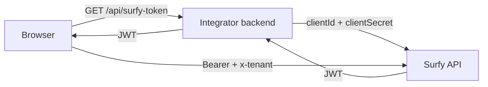

# Authentication

The SDK calls the Surfy API with a **Bearer JWT** obtained on the **integrator backend**. The client secret (`clientSecret`) must **never** be exposed in the browser.

V1 = **machine JWT** (API key / connection string). SSO / delegated user auth is **out of scope** for now.

## Recommended model



1. Your **backend** parses `SURFY_CONNECTION_STRING` (`host` / `client_id` / `client_secret`), then exchanges the credentials for a JWT (`POST /api/v1/authentication/token` — see [Surfy API](/apidocs/)).
2. Your **frontend** passes the token via `getAccessToken` (mount / React) or `setAccessTokenProvider` (Web Component).

## SDK side — JS API

```ts
import { SurfySdk } from '@surfy/surfy-sdk';

const layout = SurfySdk.mountFloor2d({
  container: '#map',
  tenant,
  baseUrl,
  floorId,
  getAccessToken: async () => {
    const response = await fetch('/api/surfy-token');
    if (!response.ok) {
      throw new Error(`Token request failed (${response.status})`);
    }
    const { token } = await response.json();
    return token;
  },
});
```

Same contract for `SurfySdk.mountBuilding3d`, `SurfyClient.create`, and React props (`getAccessToken`).

:::warning Required
Provide `getAccessToken` **at mount** (or call `setAccessTokenProvider` before the first successful load).
:::

## Headers sent by the SDK

| Header | Value |
|--------|--------|
| `Authorization` | `Bearer <token>` |
| `x-tenant` | `tenant` attribute / option |
| `accept-language` | `locale` (default `en`) |
| `Content-Type` | `application/json` |
| `X-Surfy-Sdk-Version` | SDK version (layout) |

## Backend example (Node / Express)

Prefer a single **connection string** (Key Vault / CI) rather than separate variables:

```text
host=https://app.example.surfy.pro;client_id=<tenant>;client_secret=<api-key>
```

Accepted aliases: `endpoint` / `clientId` / `clientSecret`.

```ts
type SurfyApiConnection = {
  host: string;
  clientId: string;
  clientSecret: string;
};

function parseSurfyConnectionString(raw: string): SurfyApiConnection {
  const state: Partial<SurfyApiConnection> = {};
  for (const segment of raw.trim().split(';')) {
    const piece = segment.trim();
    if (!piece) continue;
    const eq = piece.indexOf('=');
    if (eq <= 0) throw new Error(`Invalid segment "${piece}"`);
    const key = piece.slice(0, eq).trim().toLowerCase();
    const value = piece.slice(eq + 1).trim();
    if (!value) throw new Error(`Missing value for "${key}"`);
    if (key === 'host' || key === 'endpoint') state.host = value.replace(/\/$/, '');
    else if (key === 'client_id' || key === 'clientid') state.clientId = value;
    else if (key === 'client_secret' || key === 'clientsecret') state.clientSecret = value;
    else throw new Error(`Unknown key "${key}"`);
  }
  if (!state.host || !state.clientId || !state.clientSecret) {
    throw new Error('Connection string must include host, client_id, client_secret');
  }
  return state as SurfyApiConnection;
}

// Env: SURFY_CONNECTION_STRING=host=…;client_id=…;client_secret=…
// POST {host}/api/v1/authentication/token — body: { clientId, clientSecret }

app.get('/api/surfy-token', async (_req, res) => {
  const { host, clientId, clientSecret } = parseSurfyConnectionString(
    process.env.SURFY_CONNECTION_STRING ?? '',
  );

  const response = await fetch(`${host}/api/v1/authentication/token`, {
    method: 'POST',
    headers: { 'Content-Type': 'application/json' },
    body: JSON.stringify({ clientId, clientSecret }),
  });

  if (!response.ok) {
    return res.status(response.status).json({ error: 'Auth failed' });
  }

  const data = await response.json();
  return res.json({ token: data.token });
});
```

## Authentication errors

Via `onError` callback (mount / React) or `surfy:error` event (Web Component):

```ts
layout // SurfyLayout
// onError: ({ code, message }) => …
```

| Code | Meaning |
|------|---------|
| `AUTH_EXPIRED` | Expired or invalid JWT (HTTP 401) |
| `AUTH_FORBIDDEN` | Access denied (HTTP 403) |
| `SDK_CONFIG` | Required provider or option missing |

Renew the token in your provider: it is called again on each load.
