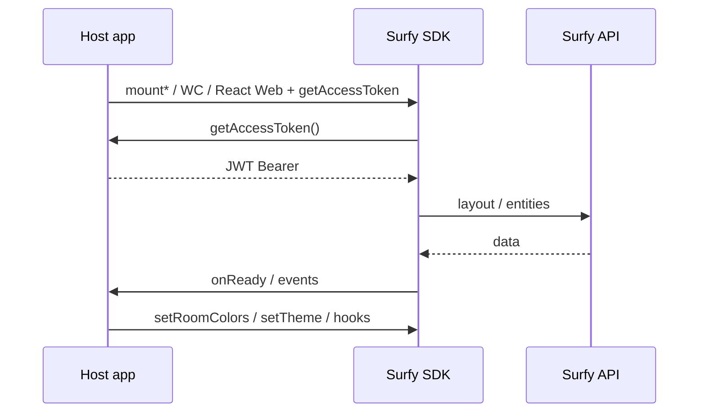

# Surfy SDK — map integration

The **Surfy SDK** (`@surfy/surfy-sdk`) lets you embed a **2D floor plan**, a **3D building**, or a **Platform view** (multi-building MapLibre + Cuby map) in **read-only** mode — without rebuilding Surfy geometry and **without** exposing `clientSecret` in the browser.

### Integrator highlights (WI-429)

- **Sole Platform entry** — `SurfyPlatformView3dReact` = **only** public React entry for the global map; `SurfyStructureCubyView3dReact` **removed**; campus / building / floor 3D React **deprecated** — [Platform view](./platform-campus-3d.md) · [Surfy React Web](./surfy-react-web.md)
- **Context control SDK** — drawers / lists = **host chrome** via `useSetCurrentZoom` / `usePositionFromGeo` (no drawers packaged in the SDK) — [context control](./platform-campus-3d.md#context-control-sdk-host-chrome)
- **Position by altitude** — `usePositionFromGeo` **only** (no calibration editing) — [altitude](./platform-campus-3d.md#position-by-altitude-usepositionfromgeo)
- **Structure → Cuby drill** — structure click → Cuby pathfinding-style look (exploded, ground floor) **in the same map**; **no** A→B routing — [drill](./platform-campus-3d.md#structure-click--cuby-pathfinding-look-same-map)
- **Structure colors** — massing aligned on `Building.color` (same SSOT as product building pathfinding)
- **React parity** (legacy layouts) — props / events / handle aligned with the JS / WC API — [Surfy React Web](./surfy-react-web.md)
- **Offline layout SDK** — `offlineEnabled` **default `true`**, SWR — [Offline layout](./surfy-react-web.md#offline-layout-floor--building) · [platform](./platform-campus-3d.md#offline-platform)
- **MapLibre** — tiles / style = **browser cache only** (no dedicated Surfy tile cache)

## Layout surfaces (+ platform + data API)

Floor / building surfaces (JS API / WC) share the **same semantics** (machine JWT auth, tenant, colors, selection). The **Platform view** is **React Web only**:

| Surface | Import | Audience |
|---------|--------|----------|
| **JavaScript API** | `@surfy/surfy-sdk` → `SurfySdk.mountFloor2d` / `mountBuilding3d` | HTML, Vue, Angular, any DOM host (floor / building) — **recommended** outside the global map |
| **Web Component** | same tags (`surfy-floor-layout-2d`, `surfy-building-layout-3d`) | HTML markup / non-React frameworks (floor / building) — **kept** |
| **Surfy React Web** | `@surfy/surfy-sdk/react` | React apps — **`SurfyPlatformView3dReact`** (global map); floor/building React layouts = **deprecated legacy** |
| **Client data API** | `@surfy/surfy-sdk/client` → `SurfyClient` | Backend or browser — buildings / floors / spaces |

```ts
import { SurfySdk } from '@surfy/surfy-sdk';

const layout = SurfySdk.mountFloor2d({
  container: '#map',
  tenant: 'my-tenant',
  baseUrl: 'https://app.surfy.pro',
  floorId: 10065,
  getAccessToken: () => fetchToken(),
});
```

`SurfyLayout` handle: `setRoomColors`, `setTheme`, `updateRoom`, `setFillParent`, callbacks `onReady` / `onRoomSelected` / `onRoomHover` / `onError`, `destroy()`. Building 3D adds `setOptions` and `fitToView`.

## Feature status

| Feature | Status |
|---------|--------|
| `SurfySdk.mountFloor2d` / `mountBuilding3d` | Available — JS API recommended outside React |
| Web Components (`surfy-floor-layout-2d`, `surfy-building-layout-3d`) | Available — same engine as `mount*` |
| Surfy React Web (`@surfy/surfy-sdk/react`) | Available — **platform** recommended; campus/building/floor3d React **deprecated** |
| **Platform view** (`SurfyPlatformView3dReact`) | Available — **sole entry** MapLibre + Cuby; structure→Cuby in-map drill; React Web only |
| `SurfyStructureCubyView3dReact` | **Removed** from the public contract — use the platform |
| `SurfyCampusView3dReact` / React building & floor 3D layouts | **Deprecated** — do not use for new embeds |
| `SurfyClient` (`@surfy/surfy-sdk/client`) | Available — QueryNode / entities |
| `setRoomColors` / `clearRoomColors` | Available (2D + building 3D) |
| `setTheme` | Available |
| `fillParent` / `setFillParent` | Available |
| `updateRoom` | Color (2D + 3D); label (building 3D) |
| React Native mobile | **Out of V1 scope** |
| SSO / delegated user auth | **Deferred** (V1 = machine JWT via backend) |

Version: `SurfySdk.version` / `SURFY_SDK_VERSION`.

The package may be consumed as a **workspace artifact** (`file:…/dist/surfy-sdk`) until npm publication opens — demos and E2E remain the delivery proof.

## Integration principle



1. Your **backend** exchanges `clientId` + `clientSecret` (or connection string) for a short-lived JWT.
2. The browser only receives the JWT via `getAccessToken` — **never** the secret.
3. You drive the render (colors, theme, 3D options) then call `destroy()` / unmount the React component.

## Guides

| Page | Content |
|------|---------|
| [Installation](./installation.md) | Package, entries `./`, `./react`, `./client` |
| [Authentication](./authentication.md) | Machine JWT, backend proxy |
| [Layout elements](./layout-elements.md) | JS `mount*` API + Web Components |
| [Surfy React Web](./surfy-react-web.md) | Public React surface = **platform**; legacy layouts, offline |
| [Platform view](./platform-campus-3d.md) | Sole entry, **Cuby drill**, host chrome / Context control SDK, `usePositionFromGeo`, offline |
| [Client data API](./client-data-api.md) | `SurfyClient` / QueryNode |
| [Theme (MUI)](./theme.md) | `setTheme` |
| [3D options](./options-3d.md) | `setOptions`, `fitToView` |
| [Spaces (`updateRoom`)](./update-room.md) | Color + label |
| [Room colors](./room-colors.md) | `setRoomColors` |
| [Layout and sizing](./layout-and-sizing.md) | CSS, `fillParent` |
| [React integration (overview)](./react-integration.md) | When to use mount vs Surfy React Web |
| [Maintain the docs](./maintenance.md) | Doc ↔ code coherence |

## Reference demo

The **surfy-sdk-demos** repo (`apps/react-web`) illustrates the surfaces and demo routes. For the global map, prefer the **platform** demo (`platform-3d`): structure click → Cuby PF-style in-map; sidebar = **host chrome** (`useSetCurrentZoom` / `usePositionFromGeo`) — not StructureCuby nor drawers packaged in the SDK. That repo’s E2E tests are part of the V1 delivery bar.
