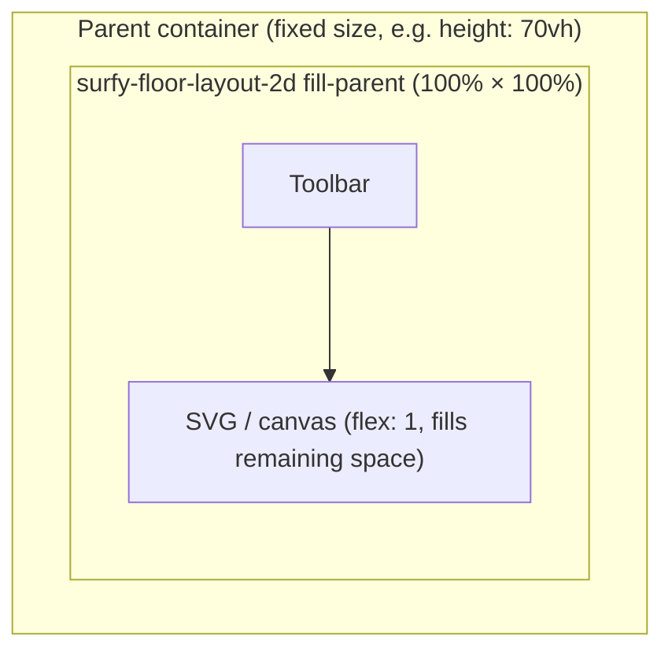

# Size and container

Layouts (Web Component or node mounted by `SurfySdk.mount*`) are `display: block` blocks. Their size depends on the **parent container**. With the JS API, prefer `fillParent: true` (default) or `layout.setFillParent(true)`.

## Fixed or relative height

```html
<style>
  .plan-container {
    width: 100%;
    height: 70vh;
    min-height: 400px;
    border: 1px solid #ddd;
  }

  .plan-container surfy-floor-layout-2d {
    display: block;
    width: 100%;
    height: 100%;
  }
</style>

<div class="plan-container">
  <surfy-floor-layout-2d
    floor-id="10065"
    tenant="surfy-demo"
    base-url="https://app.surfy.pro"
  ></surfy-floor-layout-2d>
</div>
```

The SDK uses a `ResizeObserver`: the plan resizes when the container changes (2D and 3D).

## `fill-parent` attribute

Makes the **SVG map** (or 3D canvas) occupy **100% of the width and height** of the parent container. The attribute does **not** change the parent size: the parent must already have explicit dimensions.



### Fixed-size container (demo)

```html
<style>
  .plan-host {
    width: 100%;
    height: 70vh;
    min-height: 420px;
  }

  .plan-host surfy-floor-layout-2d {
    display: block;
    width: 100%;
    height: 100%;
  }
</style>

<div class="plan-host">
  <surfy-floor-layout-2d
    fill-parent
    floor-id="10065"
    tenant="surfy-demo"
    base-url="https://app.surfy.pro"
  ></surfy-floor-layout-2d>
</div>
```

### Flex container (full screen)

To occupy **all available space** of the parent (flex, grid, etc.):

```html
<div class="layout" style="display: flex; flex-direction: column; height: 100vh;">
  <nav>...</nav>
  <div class="plan-host" style="flex: 1; min-height: 0;">
    <surfy-floor-layout-2d
      fill-parent
      floor-id="10065"
      tenant="surfy-demo"
      base-url="https://app.surfy.pro"
    ></surfy-floor-layout-2d>
  </div>
</div>
```

| Without `fill-parent` | With `fill-parent` |
|----------------------|-------------------|
| Map at minimal height (~240px) in the shadow | Element + SVG at `100%` width/height of the parent |
| Toolbar + map in natural flow | Fixed toolbar, SVG map with `flex: 1` on remaining space |

:::note Sized parent
The parent must have a **defined height** (`height`, `70vh`, `flex: 1` + `min-height: 0`, etc.). `fill-parent` stretches the map **inside** that frame; it does not enlarge the container.
:::

## Enable / disable dynamically

```ts
const el = document.querySelector('surfy-floor-layout-2d')!;

el.setAttribute('fill-parent', '');
// el.removeAttribute('fill-parent');
```

## Toolbar fonts and icons (2D)

The toolbar (zoom, fit) uses MUI in the Shadow DOM. The SDK:

1. Injects **Emotion** styles into the shadow root
2. Loads `{base-url}/assets/fontawesome/...`, `surfyicon`, `icomoon` stylesheets

Make sure `base-url` points to a Surfy instance that serves `/assets/` (same origin as the API).

## Common layout errors

| Symptom | Cause | Fix |
|---------|-------|-----|
| Invisible plan (height 0) | Parent without height | Give the container a `height` or `flex: 1` |
| Broken toolbar icons | Incorrect `base-url` | Check the URL and access to `/assets/` |
| Plan too small | Missing `min-height` | `min-height: 400px` or more on the container |
| Black 3D canvas | Container without dimensions | Same rules as 2D — CubyV2 needs an explicit size |
