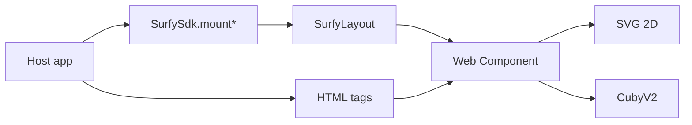

# Layouts — JavaScript API and Web Components

Two ways to embed the **same** render (Shadow DOM):

1. **JavaScript API** — `SurfySdk.mountFloor2d` / `SurfySdk.mountBuilding3d` (recommended outside React)
2. **Web Component** — HTML tags + DOM methods / events

For a **multi-building map** in React, use [Platform view](./platform-campus-3d.md) (`SurfyPlatformView3dReact`). React floor / building / floor 3D layouts are **deprecated** as a public contract — for a floor or building plan outside the global map, prefer **`mount*` / Web Components** (this page). See [Surfy React Web](./surfy-react-web.md).

### React (legacy) ↔ mount* / WC parity

| Semantics | JS / WC API (**recommended** outside platform) | Surfy React Web (floor/building layouts = **deprecated**) |
|-----------|-------------|-----------------|
| Floor 2D | `mountFloor2d` / `<surfy-floor-layout-2d>` | `SurfyFloorLayout2dReact` |
| Building 3D | `mountBuilding3d` / `<surfy-building-layout-3d>` | `SurfyBuildingLayout3dReact` |
| Ready / error | `onReady` / `onError` · `surfy:ready` / `surfy:error` | `onReady` / `onError` props |
| Hover / selection | `onRoomHover` / `onRoomSelected` · DOM events | `onRoomHover` / `onRoomSelected` props |
| 3D options | `setOptions` / `fitToView` | `ref.setOptions` / `ref.fitToView` (+ `layout3dOptions` prop) |
| Colors | `setRoomColors` / `clearRoomColors` / `updateRoom` | same on `ref` (+ `roomColors` prop) |
| Offline | (same engine when self-fetch) | `offlineEnabled` prop (**default `true`**) |

**Platform view**: React only — [Platform view](./platform-campus-3d.md) (no `mount*` / WC). Floor & building tags / `mount*` remain the public contract for classic embeds.

| Kind / tag | Render | Status |
|------------|--------|--------|
| `floor-2d` / `<surfy-floor-layout-2d>` | 2D floor plan (SVG) | **Available** |
| `building-3d` / `<surfy-building-layout-3d>` | Multi-floor 3D building (CubyV2) | **Available** (SDK alpha) |

```ts
import { SurfySdk } from '@surfy/surfy-sdk';

const layout = SurfySdk.mountBuilding3d({
  container: '#map', // HTMLElement or CSS selector
  tenant: 'my-tenant',
  baseUrl: 'https://app.surfy.pro',
  buildingId: 42,
  getAccessToken: () => fetchToken(),
  onReady: () => console.log('ready'),
  onError: (err) => console.error(err),
});

layout.setRoomColors({ 1001: '#2196F3' });
layout.setOptions({ showRoomLabels: true });
layout.fitToView();
layout.destroy();
```



## `SurfyLayout` (`mount*` handle)

| Method | Description |
|--------|-------------|
| `setAccessTokenProvider` | Bearer JWT — see [Authentication](./authentication.md) |
| `setRoomColors` / `clearRoomColors` | See [Colors](./room-colors.md) |
| `updateRoom` | See [updateRoom](./update-room.md) |
| `setTheme` | See [Theme](./theme.md) |
| `setOptions` / `fitToView` / `zoomOn` | See [3D options](./options-3d.md) (`setOptions` no-op in 2D) |
| `setFillParent` | Fill the container |
| `setEntityId` | Change `floorId` / `buildingId` |
| `getRenderedRoomIds` | Space ids present in the rendered DOM |
| `destroy` | Removes the element and listeners |

Helpers: `SurfySdk.isKindRegistered(kind)`, `SurfySdk.tagForKind(kind)`, `SurfySdk.version`.

### `mountFloor2d` options

| Field | Required | Description |
|-------|----------|-------------|
| `container` | yes | `HTMLElement` or selector |
| `tenant` | yes | Tenant slug |
| `baseUrl` | yes | API origin without trailing slash |
| `floorId` | yes | Floor id |
| `getAccessToken` | yes | `() => Promise<string>` |
| `locale` / `fillParent` / `theme` | no | Locale, sizing, theme |
| `onReady` / `onRoomHover` / `onRoomSelected` / `onError` | no | Typed callbacks |

### `mountBuilding3d` options

Same as above with `buildingId` (required), plus optional `floorIds?` (floor subset) and `options?` (`SurfyLayout3dOptions`).

The SDK checks `window` / `document` and throws `SDK_CONFIG` if the tag is not registered or the container is invalid.

## Web Component

```html
<surfy-floor-layout-2d
  floor-id="10065"
  tenant="my-tenant"
  base-url="https://app.surfy.pro"
  fill-parent
></surfy-floor-layout-2d>
```

```ts
import '@surfy/surfy-sdk'; // registers tags
import type { SurfyLayoutElement } from '@surfy/surfy-sdk';

const el = document.querySelector('surfy-floor-layout-2d') as SurfyLayoutElement;
el.setAccessTokenProvider(() => fetchToken());
el.addEventListener('surfy:ready', () => {
  el.setRoomColors({ 577183: '#2196F3' });
});
```

### Common attributes

| Attribute | Required | Description |
|-----------|----------|-------------|
| `tenant` | yes | Tenant slug (`x-tenant`) |
| `base-url` | yes | API origin, no trailing slash |
| `locale` | no | `accept-language`, default `en` |
| `fill-parent` | no | 100% of parent — see [Sizing](./layout-and-sizing.md) |
| `floor-id` | 2D | Floor id |
| `building-id` | building 3D | Building id |

### DOM events

| Event | `detail` (indicative) |
|-------|----------------------|
| `surfy:ready` | Ready layout id |
| `surfy:error` | `{ code, message }` |
| `surfy:room-selected` | `{ roomId, name }` |
| `surfy:room-hover` | `{ roomId, name }` or `null` |

`mount*` callbacks replace `addEventListener` for the same contract.

### Escape hatch

`layout.element` exposes the custom element (`SurfyLayoutElement`) for tests or advanced use.

See also [Installation](./installation.md), [Authentication](./authentication.md), [Sizing](./layout-and-sizing.md).
