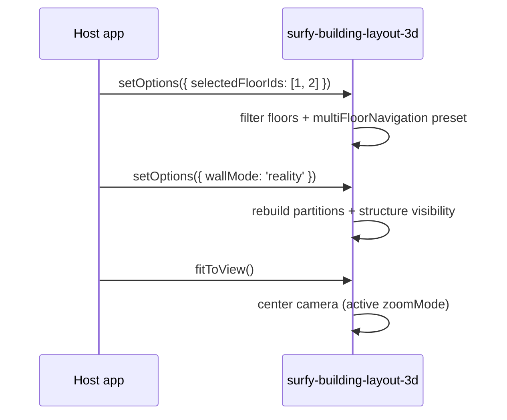

# 3D options (`setOptions` / `fitToView`)

**CubyV2** views expose display settings via `setOptions`. Calls are **merged**: each invocation updates only the keys you provide.

| Element | `setOptions` | `fitToView` |
|---------|--------------|-------------|
| `<surfy-floor-layout-2d>` | ignored (no-op) | stub (not implemented) |
| `<surfy-floor-layout-3d>` | planned (element not registered yet) | planned |
| `<surfy-building-layout-3d>` | **available** | **available** |

## `setOptions(options)`

```ts
import { SurfySdk, type SurfyLayout3dOptions } from '@surfy/surfy-sdk';

const building = SurfySdk.mountBuilding3d({
  container: '#map',
  tenant,
  baseUrl,
  buildingId,
  getAccessToken,
  onReady: () => {
    building.setOptions({
      floorSpace: 320,
      showRoomLabels: false,
      showFloorLabels: true,
      buildingRotationZ: 15,
      selectedFloorIds: [101, 102],
      wallMode: 'no',
      showStructureWalls: true,
      structureFloorIds: [101],
      singleFloorNavigation: { controls: 'map', zoomMode: 'zenith' },
      multiFloorNavigation: { controls: 'building', zoomMode: 'isometric' },
    } satisfies SurfyLayout3dOptions);
  },
});
```

You can call `setOptions` **before** `onReady`: values are kept and applied when the scene loads.

## React equivalent (`ref` / props)

On **Surfy React Web**, the same contract applies via the component handle (no Web Component required):

| JS / WC API | React |
|-------------|--------|
| `layout.setOptions({ selectedFloorIds })` | `ref.current.setOptions({ selectedFloorIds })` |
| `layout.fitToView()` | `ref.current.fitToView()` |
| mount options (`options?`) | `layout3dOptions` prop |

```tsx
import { useRef } from 'react';
import {
  SurfyBuildingLayout3dReact,
  type SurfyBuildingLayout3dReactHandle,
} from '@surfy/surfy-sdk/react';

const ref = useRef<SurfyBuildingLayout3dReactHandle>(null);

<SurfyBuildingLayout3dReact
  ref={ref}
  buildingId={buildingId}
  tenant={tenant}
  baseUrl={baseUrl}
  getAccessToken={fetchToken}
  layout3dOptions={{ showRoomLabels: false }}
  fillParent
/>

// Later, from a button outside the component:
ref.current?.setOptions({ selectedFloorIds: [101, 102] });
ref.current?.fitToView();
```

See [Surfy React Web — parity](./surfy-react-web.md#parity-with-js-api--web-component).

## Type `SurfyLayout3dOptions`

| Option | Type | Default | Description |
|--------|------|---------|-------------|
| `floorSpace` | `number` | `240` | Vertical spacing between floors (px) |
| `showRoomLabels` | `boolean` | `true` | Space labels in the scene |
| `showFloorLabels` | `boolean` | `true` | Floor labels |
| `buildingRotationZ` | `number` | `0` | Building rotation around Z (degrees) |
| `selectedFloorIds` | `number[]` | all floors in the layout | Visible floors |
| `wallMode` | `SurfyLayout3dWallMode` | `'no'` | Partition wall render mode |
| `showStructureWalls` | `boolean` | `false` | Show building structures |
| `structureFloorIds` | `number[]` | all visible floors | Floors whose structure is shown |
| `singleFloorNavigation` | `SurfyLayout3dNavigationOptions` | `{ controls: 'map', zoomMode: 'zenith' }` | Navigation when **one** floor is selected |
| `multiFloorNavigation` | `SurfyLayout3dNavigationOptions` | `{ controls: 'building', zoomMode: 'isometric' }` | Navigation when **several** floors are visible |

### `wallMode` (`SurfyLayout3dWallMode`)

| Value | Description |
|-------|-------------|
| `'cuby'` | Cuby cartography style — hides desks, furniture and structures (no desk/item raycast) |
| `'no'` | No walls (**default**) — desks and furniture visible and pickable |
| `'half'` | Half-height walls |
| `'reality'` | “Realistic” render |
| `'cuby-reality-selected'` | Furniture/desks only in selected spaces |
| `'no-wall-selected'` | Same as above, without walls on non-selected spaces |

### Structure

`showStructureWalls` controls visibility of structure meshes (slab + walls if created at load).
`structureFloorIds` limits display to certain floors. Omitting the key means “all visible floors”.

:::note Structure wall geometry
Structure walls are generated only on the **first load** if `showStructureWalls` is `true`. A later toggle shows or hides the existing 3D group.
:::

### Navigation (`SurfyLayout3dNavigationOptions`)

| Key | Type | Values | Role |
|-----|------|--------|------|
| `controls` | `SurfyLayout3dControls` | `'map'` · `'orbit'` · `'building'` | Camera manipulation scheme |
| `zoomMode` | `SurfyLayout3dZoomMode` | `'zenith'` · `'isometric'` | Default framing (`fitToView` / floor changes) |

The **single** preset applies when one floor is in `selectedFloorIds`; the **multi** preset when several floors are visible.

## Dynamic updates

```ts
// Hide a floor
building.setOptions({ selectedFloorIds: [102] });

// Realistic mode with structures on floor 102
building.setOptions({
  wallMode: 'reality',
  showStructureWalls: true,
  structureFloorIds: [102],
});

// Orbit navigation + isometric view in multi-floor
building.setOptions({
  multiFloorNavigation: { controls: 'orbit', zoomMode: 'isometric' },
});
building.fitToView();
```



## `fitToView()`

Recenters the camera on the current 3D scene (selected floors, spacing, rotation, and active preset `zoomMode` are taken into account).

```ts
building.fitToView();
```

Useful after changing `selectedFloorIds`, `floorSpace`, navigation (`zoomMode`), or container size.

:::tip Demo
**surfy-sdk-demos** — “Building 3D” tab: **3D options** panel with floors, wall mode, per-floor structure, and navigation presets.
:::

## What is not exposed

Internal Surfy Work Canvas options (map filters, analysis layers, UI floor picker, etc.) are **not** configurable via the SDK. Only `SurfyLayout3dOptions` keys are the public contract.

For the **Platform view**, the public contract is React (props + hooks) — not `setOptions` on a WC element. Building / floor focus and structure→Cuby drill go through `useSetCurrentZoom` / structure click; **massing** colors follow `Building.color` (not `setRoomColors`). See [Platform view](./platform-campus-3d.md).

React building / floor 3D layouts remain documented here for `ref.setOptions` parity (deprecated legacy) — prefer `mountBuilding3d` / WC for new embeds outside the platform.

See [Layout elements — building 3D](./layout-elements.md) and [Layout and sizing](./layout-and-sizing.md).
